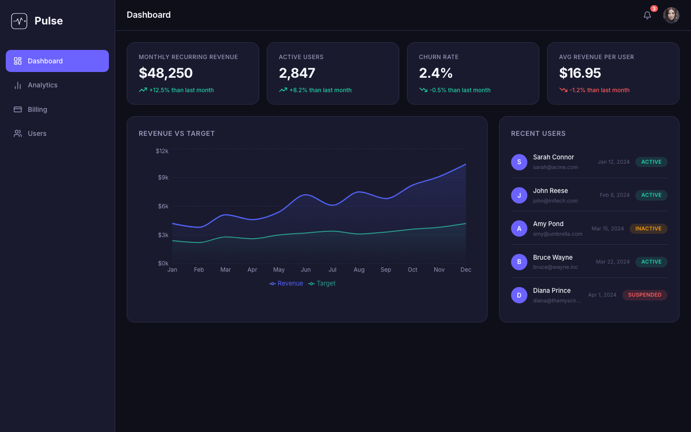
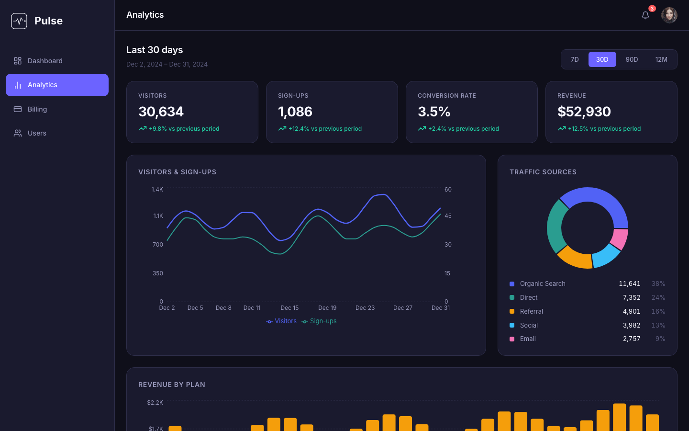
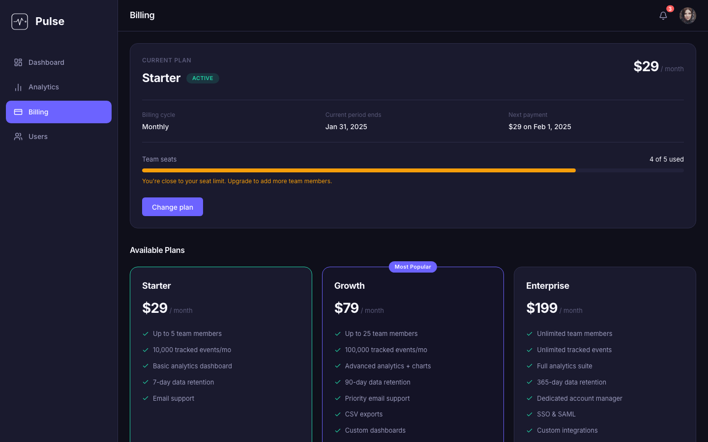
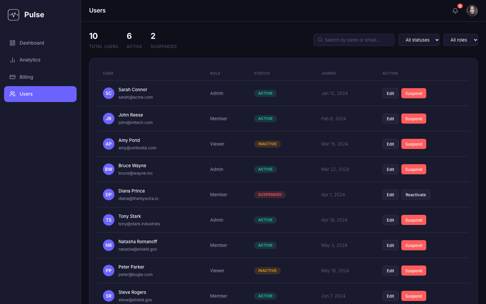
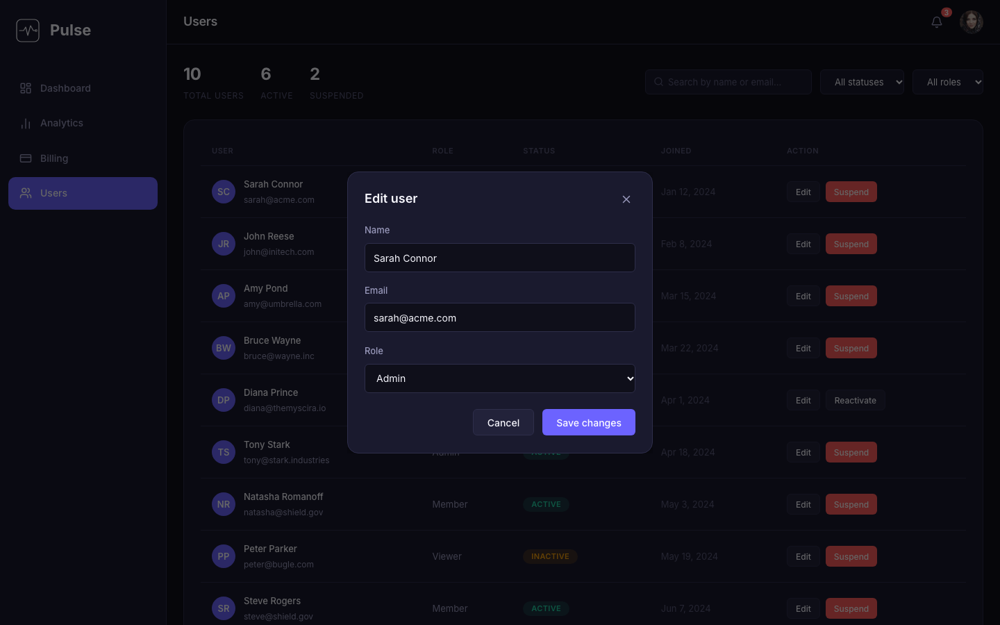
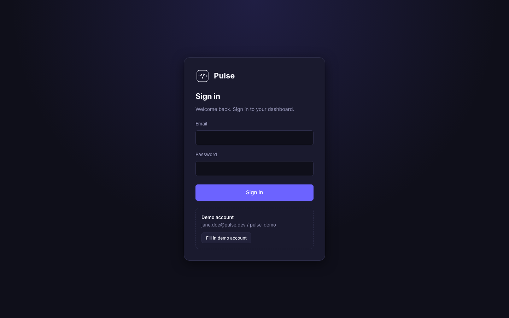
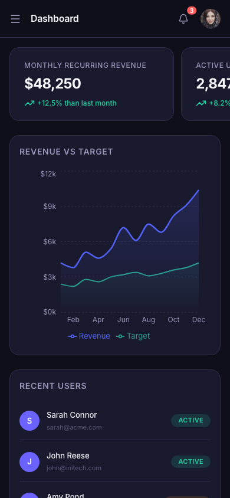
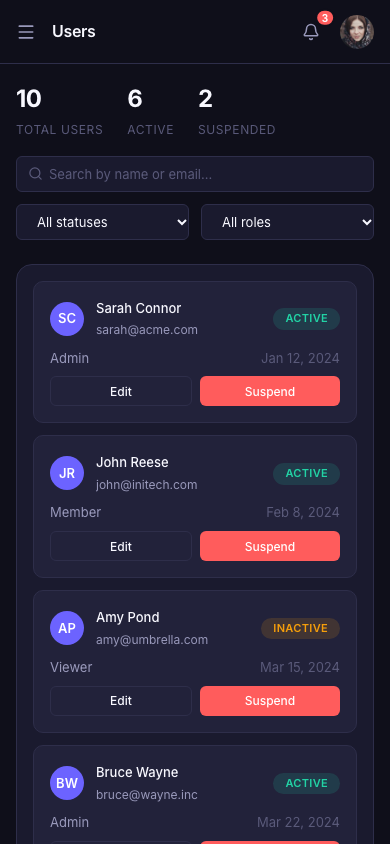
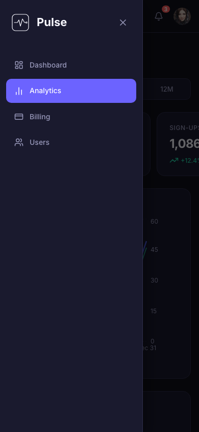

# Pulse

**A SaaS admin dashboard built with React 19 and TypeScript**, covering
analytics, user management, billing, notifications and authentication. It's
fully responsive from phone to desktop.

### [Live demo → shakyaanup.github.io/pulse](https://shakyaanup.github.io/pulse/)

Sign in with the demo account (the login page can also fill it in for you):

| Email | Password |
|---|---|
| `jane.doe@pulse.dev` | `pulse-demo` |



---

## Features

**Dashboard.** Revenue, users, churn and ARPU at a glance, a revenue vs target
chart, and the latest sign-ups.

**Analytics.** A 7-day / 30-day / 90-day / 12-month range picker drives every
number on the page: KPI cards, a dual-axis visitors vs sign-ups chart, a traffic
sources donut, revenue by plan (stacked bars) and sortable breakdown tables.

**Users.** Live search, status and role filters, suspend / reactivate, and an
**edit form** in a modal with field validation and server-side errors (for
example "email already taken").

**Billing.** The current plan with a team-seat meter, **plan switching**
(upgrade / downgrade, with a rule blocking plans that have too few seats), and
a sortable **billing history**.

**Notifications and profile menu.** Unread badge, mark as read / mark all,
click-through to the related page, and an account menu with an avatar that falls
back to initials.

**Authentication.** A login page, protected routes, and redirect back to the page
you asked for after signing in.

**Saved data.** Edits, suspensions, read notifications, the chosen plan and the
session all survive a reload (`localStorage`). **Reset demo data** in the
profile menu starts fresh.

**Responsive.** Full sidebar on desktop, an icon rail on tablets, and a
slide-out menu on phones. User rows become cards and KPI cards become a
swipeable row.

**Accessible.** Real buttons and links, ARIA state on menus and dialogs, focus
management (Escape closes, focus returns), screen-reader labels and live
regions.

---

## Screenshots

| Analytics | Billing |
|---|---|
|  |  |

| Users | Edit user |
|---|---|
|  |  |

| Login | |
|---|---|
|  | |

**On a phone**

| Dashboard | Users | Menu |
|---|---|---|
|  |  |  |

---

## Tech stack

| | |
|---|---|
| **UI** | React 19, TypeScript, React Router 7 |
| **Charts** | Recharts |
| **Styling** | SCSS with BEM naming, design tokens, responsive mixins |
| **Icons** | lucide-react |
| **Testing** | Jest, React Testing Library (56 tests) |
| **Tooling** | Create React App, ESLint, Prettier |
| **Hosting** | GitHub Pages |

There's no backend. Data comes from mock services in `src/services/` that
behave like an API, with network delays, errors and `PATCH`-style updates. Each
service function notes the real `apiClient` call that would replace it, so
connecting a backend wouldn't require changing any components.

---

## Getting started

Requires Node.js 18 or later.

```bash
git clone https://github.com/shakyaanup/pulse.git
cd pulse
npm install
npm start          # http://localhost:3000
```

| Command | What it does |
|---|---|
| `npm start` | Development server with hot reload |
| `npm test` | Run the test suite (watch mode) |
| `npm run lint` | ESLint |
| `npm run build` | Production build into `build/` |
| `npm run deploy` | Build for GitHub Pages and publish to the `gh-pages` branch |

---

## Project structure

```
src/
├── pages/            Dashboard, Analytics, Billing, UserManagement, Login
├── components/
│   ├── common/       Reusable UI: Card, Button, Badge, Modal, DataTable, Avatar…
│   ├── layout/       PageWrapper, Sidebar, Navbar, NotificationBell, ProfileMenu
│   ├── analytics/    Charts and the date range picker
│   └── auth/         RequireAuth route guard
├── context/          Auth, Subscription and Notifications state
├── hooks/            useDropdown, usePersistentState
├── services/         Mock API (users, auth), mock data, localStorage wrapper
├── styles/           SCSS: tokens, mixins, layout, pages, components
├── types/            Shared TypeScript types
└── utils/            Formatters (currency, dates, relative time…)
```

---

## How it was built: tutorials

Each feature has a walkthrough in [`docs/`](docs/) explaining the code and the
reasoning behind it:

| Tutorial | Covers |
|---|---|
| [Dashboard and app foundations](docs/dashboard-page-tutorial.md) | Routing and code splitting, layout, SCSS system, Recharts basics |
| [Analytics](docs/analytics-page-tutorial.md) | Derived state, deterministic mock data, dual-axis and stacked charts, a generic sortable table |
| [Users](docs/users-page-tutorial.md) | Async loading, controlled filters, optimistic updates, a `<dialog>` modal, form validation |
| [Billing](docs/billing-page-tutorial.md) | Plan vs subscription modelling, plan switching, seat rules, billing history |
| [Notifications](docs/notifications-tutorial.md) | React Context, relative time with `Intl`, outside-click and Escape handling |
| [Profile menu](docs/profile-menu-tutorial.md) | Writing a custom hook, avatar fallback, SCSS mixins |
| [Responsive layout](docs/responsive-layout-tutorial.md) | Breakpoints, icon rail and drawer, table strategies, swipeable KPI cards |
| [Login and saved data](docs/auth-and-saved-data-tutorial.md) | Auth context, protected routes, `localStorage` persistence |

---

## Notes

- **Authentication is front-end only.** It demonstrates routing and state
  patterns, not security. A real app would verify credentials on a server and
  use an `httpOnly` session cookie. The [auth tutorial](docs/auth-and-saved-data-tutorial.md)
  explains the difference.
- Avatar photos come from [pravatar.cc](https://pravatar.cc). If it's
  unavailable, avatars fall back to initials.
